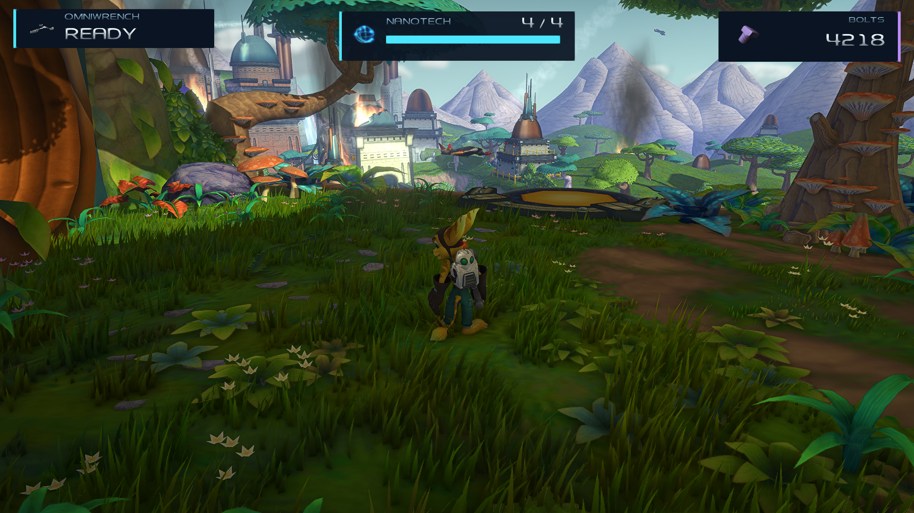
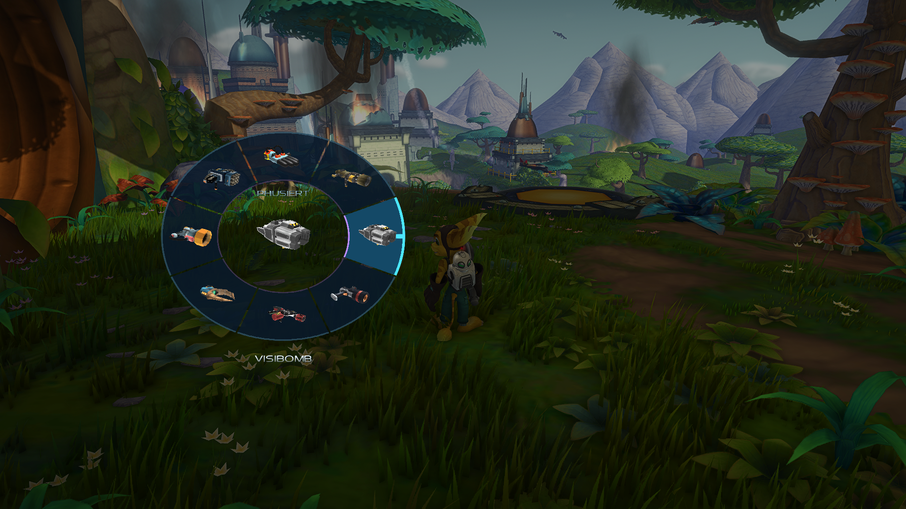
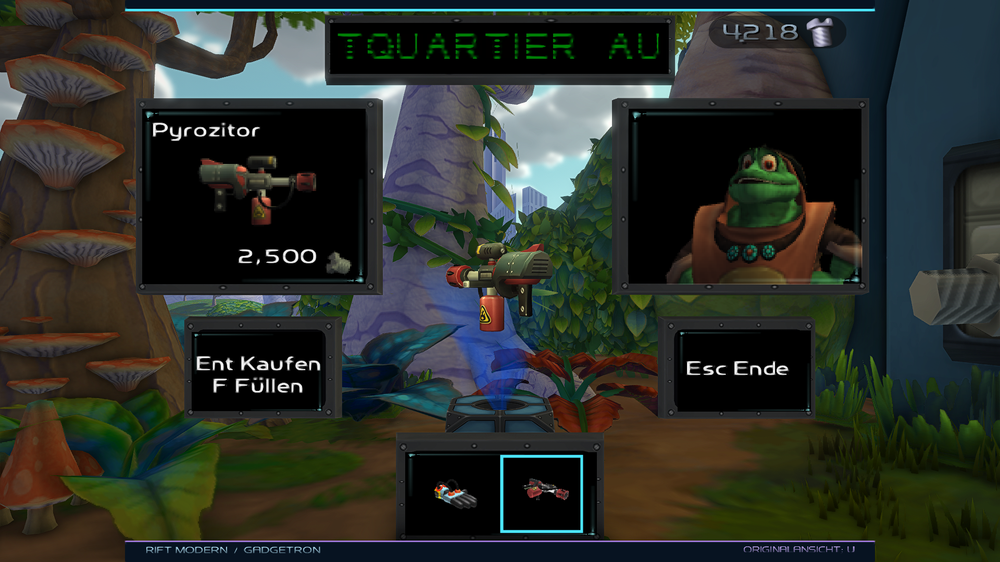
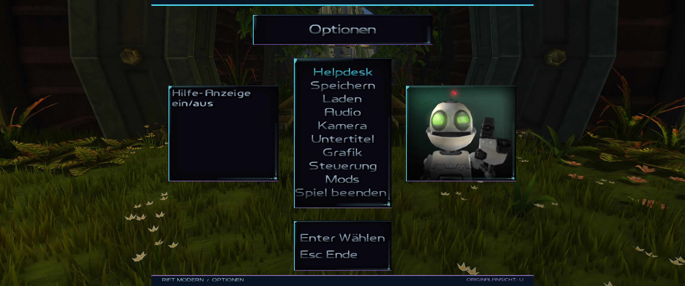
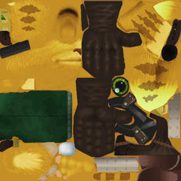
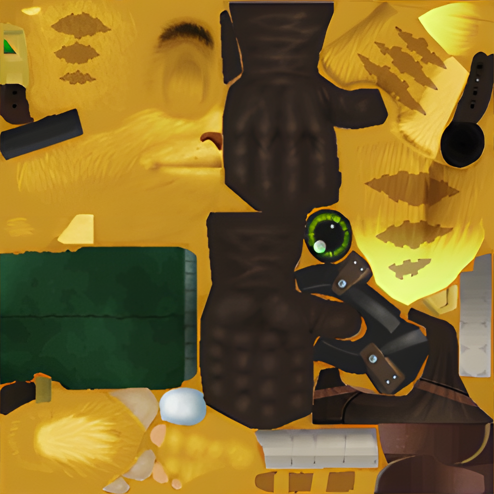
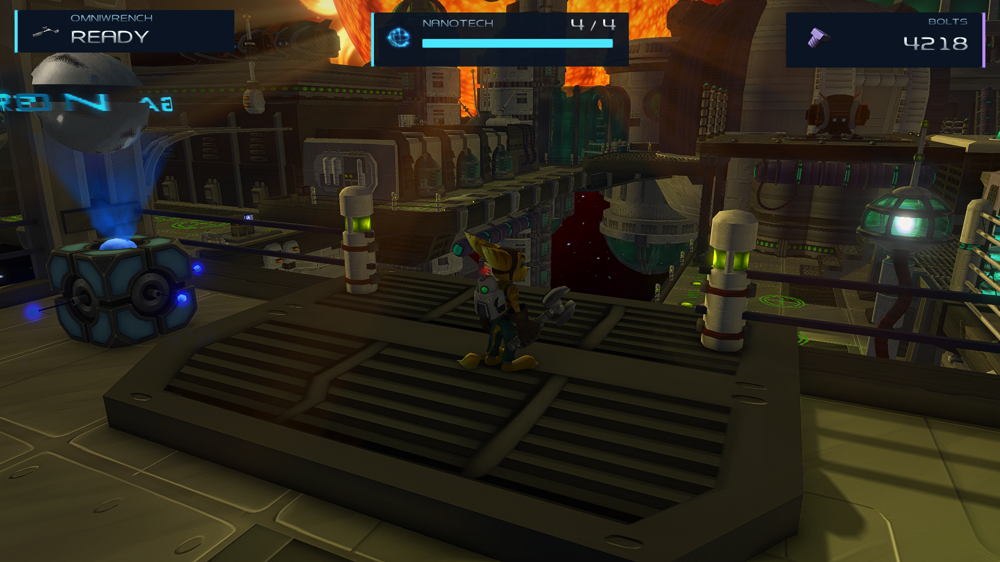

# RAC-RS Mods — Taurus0815

[Deutsch](#deutsch) · [English](#english) · [Vorschaubilder / Previews](#vorschaubilder--previews)

Eigene Mods für Ratchet & Clank 1 im PC-Port RAC-RS. / Custom mods for Ratchet & Clank 1 in the RAC-RS PC port.

**Ersteller / Author: Taurus0815**

## Downloads

Direkte ZIP-Downloads / Direct ZIP downloads:

| Paket / Package | Version | Download |
| --- | --- | --- |
| Rift Modern | 0.12.2 | [rift-modern-0.12.2.zip](https://github.com/Taurus0815/RAC-RS-Mods/raw/refs/heads/main/downloads/rift-modern-0.12.2.zip) |
| HQ Texture Remake — **beide Teile / both parts** | 2.0.0 | [Teil 1 / Part 1](https://github.com/Taurus0815/RAC-RS-Mods/releases/download/hq-texture-remake-v2.0.0/hq-texture-remake-2.0.0-part01.zip) · [Teil 2 / Part 2](https://github.com/Taurus0815/RAC-RS-Mods/releases/download/hq-texture-remake-v2.0.0/hq-texture-remake-2.0.0-part02.zip) |
| HQ Texture Remake Lite — Figuren/Waffen / characters/weapons | 1.0.0 | [hq-texture-remake-1.0.0.zip](https://github.com/Taurus0815/RAC-RS-Mods/raw/refs/heads/main/downloads/hq-texture-remake-1.0.0.zip) |
| Rift Modern: nativer Quellpatch / native source patch | RAC-RS 0.4.3 | [rift-modern-native-patch-0.4.3.zip](https://github.com/Taurus0815/RAC-RS-Mods/raw/refs/heads/main/downloads/rift-modern-native-patch-0.4.3.zip) |

[Prüfsummen der Mod-Pakete / mod package checksums](downloads/SHA256SUMS.txt) · [HQ 2.0.0 SHA-256](downloads/SHA256SUMS-HQ-2.0.0.txt)

## Deutsch

### Rift Modern

**0.12.2:** Schultermodus: Schüsse folgen der Blickrichtung beim seitlichen und rückwärtigen Laufen; Zoom erst beim Halten der Zieltaste. / Shoulder mode: camera-directed firing while strafing/backpedaling; zoom starts only on a sustained aim hold.

**0.12.1:** Behebt den Stillstand trotz Laufanimation auf Kerwan. Der native Auswahlrad-Patch wurde korrigiert; die Scripts aktivieren keine alten unsicheren Ausblendungsroutinen mehr. / Fixes walking in place on Kerwan. The native wheel patch is corrected; scripts no longer enable unsafe legacy guards.

- Von Rift Apart inspiriertes HUD und Menüdesign mit Cyan- und Violett-Akzenten.
- Reaktionsschnelleres Laufen, Beschleunigen und Abbremsen mit nativer Kollision.
- Zweimal kurz Zielen antippen schaltet die Schulteransicht samt seitlicher und rückwärtiger Bewegung ein oder aus. Schüsse folgen dabei der Blickrichtung. Kurze Taps zoomen nicht; erst gehaltenes Zielen blendet den Zielzoom ein.
- **Zielen halten + Viereck wirft den Schraubschlüssel** über den ursprünglichen Comet-Strike-Ablauf. Auf Xbox-Controllern: LT + X. Viereck allein bleibt Nahkampf; die eingerastete Schulteransicht allein zählt nicht als gehaltenes Zielen.
- Kompaktes, pausiertes Auswahlrad mit farbigen Waffenbildern und scharfen Konturen. Die ursprüngliche Öffnungszeit für die Händler-Interaktion bleibt erhalten.
- Waffenbilder statt Silhouetten auch im HUD und beim Händler.
- Einstellbare Schraubschlüssel-Geschwindigkeit, Aufschlag-Radien und Bolt-Anziehung.
- Eigene Belegungen über die Spiel- und Mod-Optionen; Launcher-Einstellungen werden beibehalten.

**Installation:** ZIP entpacken, den vollständigen Ordner `rift-modern` einschließlich `images` und `textures` in den `mods`-Ordner der eigenen RAC-RS-Installation kopieren und im Launcher aktivieren. Vorhandene Dateien vorher sichern.

Für Schulterbewegung, nativen Menü-Skin und die hochauflösenden Bilder im eigenen Auswahlrad wird zusätzlich der oben verlinkte **Quellpatch für RAC-RS 0.4.3** benötigt. Er wird auf den Player-Quellcode angewendet; danach muss der Player neu gebaut werden. Die Script-ZIP allein installiert diese Erweiterung nicht. [Anleitung](native-patch/README.md).

Wenn beide Mods aktiv sind, **Rift Modern vor HQ Texture Remake** einordnen, damit die Waffenbilder Vorrang vor den ursprünglichen HUD-Symbolen haben. Die Gesundheitsanzeige verwendet standardmäßig die originale Spielgesundheit. Es wird keine fremde Mod mitgeliefert.

### HQ Texture Remake

Originalgetreue lokale **4×-Hochskalierung**: **4.415 unterschiedliche Grundtexturen, 26.818 PNG-Ersetzungen**. Version 2.0.0 erweitert das Pack auf Landschaften, Gebäude, Gegner, Gegenstände und Vegetation aller 19 Planeten sowie benannte Himmel-, Effekt-, Partikel-, HUD-, Titel-, Schiffs- und Warp-Texturen. Ratchet, Clank und die Waffen bleiben enthalten. UV-Anordnung, Seitenverhältnisse und originale Transparenz bleiben erhalten; die größte Ausgabe misst 2048 × 1024 Pixel.

**Installation:** **Beide ZIP-Teile von Version 2.0.0** herunterladen und in denselben `mods`-Ordner entpacken. Den enthaltenen Ordner `hq-texture-remake` zusammenführen, im Launcher aktivieren und das Spiel neu starten. Version 2.0.0 ersetzt 1.0.0. Die kleinere 1.0.0 bleibt als Alternative für Figuren und Waffen verfügbar. Rift Modern vor HQ Texture Remake einordnen. [Paket-Anleitung](mods/hq-texture-remake/README.md).

Die Dateizuordnungen wurden gegen alle 19 Planetendatensätze geprüft; zusätzlich wurden frühe und späte Planeten im Player geladen und visuell kontrolliert. Laufend erzeugte Render-Targets, Videos und vom Player ausdrücklich ausgenommene Effekt-Slots bleiben nativ. Ein vollständiger Spieldurchlauf ist kein Teil dieser Prüfung. Das Pack benötigt keinen eigenen Player-Build. Erstellt mit lokal ausgeführtem [Real-ESRGAN x4plus](https://github.com/xinntao/Real-ESRGAN).

### Prüfung und Umfang

Geprüft mit RAC-RS 0.4.3, PAL SCES-50916 v1.00, OmniLoader 0.1.0, Host-ABI 1.6 und Script-API 1.3. Ergebnisse und Grenzen stehen im [Testbericht](TESTBERICHT.md).

**Arsenal Mastery und Wardrobe sind nicht enthalten.** Persönliche Einstellungen, Speicherstände, Disc-Dateien und eine komplette Spielinstallation werden ebenfalls nicht mitgeliefert. Lizenzen und Herkunftsangaben liegen bei den jeweiligen Dateien.

## English

### Rift Modern

- Rift Apart-inspired HUD and menu styling with cyan and violet accents.
- More responsive movement, acceleration and braking with native collision.
- Double-tap aim to toggle shoulder framing with camera-relative sideways/backward movement and firing along the camera view. Short taps do not zoom; a sustained aim hold blends into the aiming distance.
- **Hold aim + press Square to throw the Omniwrench** using the original Comet Strike sequence. On Xbox controllers: LT + X. Square alone remains melee; toggled shoulder walking alone does not count as holding aim.
- Compact paused quick-select wheel with full-colour weapon pictures and crisp edges. The original opening timing for vendor interactions is preserved.
- Weapon pictures replace silhouettes in the HUD and at vendors as well.
- Adjustable wrench animation speed, ground-impact radii and bolt attraction.
- Custom bindings through the game and mod settings; launcher preferences are preserved.

**Installation:** Extract the ZIP, copy the complete `rift-modern` folder, including `images` and `textures`, into your RAC-RS `mods` folder and enable it in the launcher. Back up existing files first.

Shoulder movement, the native menu skin and high-resolution pictures in the custom wheel additionally require the **RAC-RS 0.4.3 source patch** linked above. Apply it to the player source and rebuild the player; the script ZIP does not install that player extension. [Instructions](native-patch/README.md).

When both mods are enabled, place **Rift Modern above HQ Texture Remake** so weapon pictures take priority over the original HUD symbols. Health rendering defaults to the original game's health. No third-party mod is bundled.

### HQ Texture Remake

A faithful local **4× upscale**: **4,415 unique base textures and 26,818 PNG replacements**. Version 2.0.0 expands coverage to terrain, buildings, enemies, objects and vegetation across all 19 planets, plus named sky, effects, particles, HUD, title, ship and warp textures. Ratchet, Clank and weapons remain included. UV layout, aspect ratios and original transparency are preserved; the largest output is 2048 × 1024 pixels.

**Installation:** Download **both version 2.0.0 ZIP parts** and extract them into the same `mods` directory, merging `hq-texture-remake`. Enable it in the launcher and restart the game. Version 2.0.0 replaces 1.0.0. The smaller 1.0.0 remains available as a characters-and-weapons alternative. Place Rift Modern above HQ Texture Remake. [Package instructions](mods/hq-texture-remake/README.md).

File mappings were checked against all 19 planet datasets, with early and late planets also loaded and visually inspected in the player. Runtime render targets, videos and explicitly excluded effect slots remain native. These checks are not a full playthrough. The pack does not require a custom player build. Created with locally executed [Real-ESRGAN x4plus](https://github.com/xinntao/Real-ESRGAN).

### Verification and scope

Checked with RAC-RS 0.4.3, PAL SCES-50916 v1.00, OmniLoader 0.1.0, host ABI 1.6 and script API 1.3. Results and limits are documented in the [test report](TESTBERICHT.md).

**Arsenal Mastery and Wardrobe are not included.** Personal settings, save files, disc data and a complete game installation are also excluded. Each component includes its license and provenance information.

## Vorschaubilder / Previews

### Rift Modern — HUD

Aufnahme mit Rift Modern und HQ Texture Remake. / Captured with Rift Modern and HQ Texture Remake.

### Rift Modern — Auswahlrad / Quick Select

### Rift Modern — Händler / Vendor

### Rift Modern — Menü / Menu

### HQ Texture Remake — Ratchet

Dieselbe Textur vor und nach der 4×-Hochskalierung, gleich groß dargestellt. / The same texture before and after 4× upscaling, displayed at equal size.

| Original — 256 × 256 | HQ Texture Remake — 1024 × 1024 |
| --- | --- |
|  |  |

### HQ Texture Remake 2.0.0 — Welt / World

Novalis:

Gemlik-Basis / Gemlik Base:

