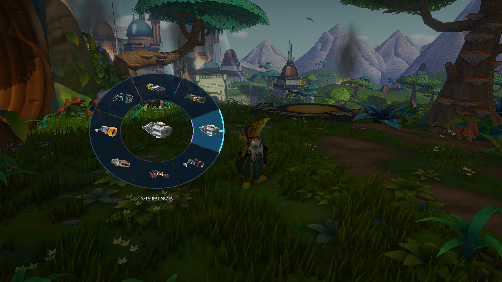
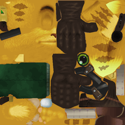
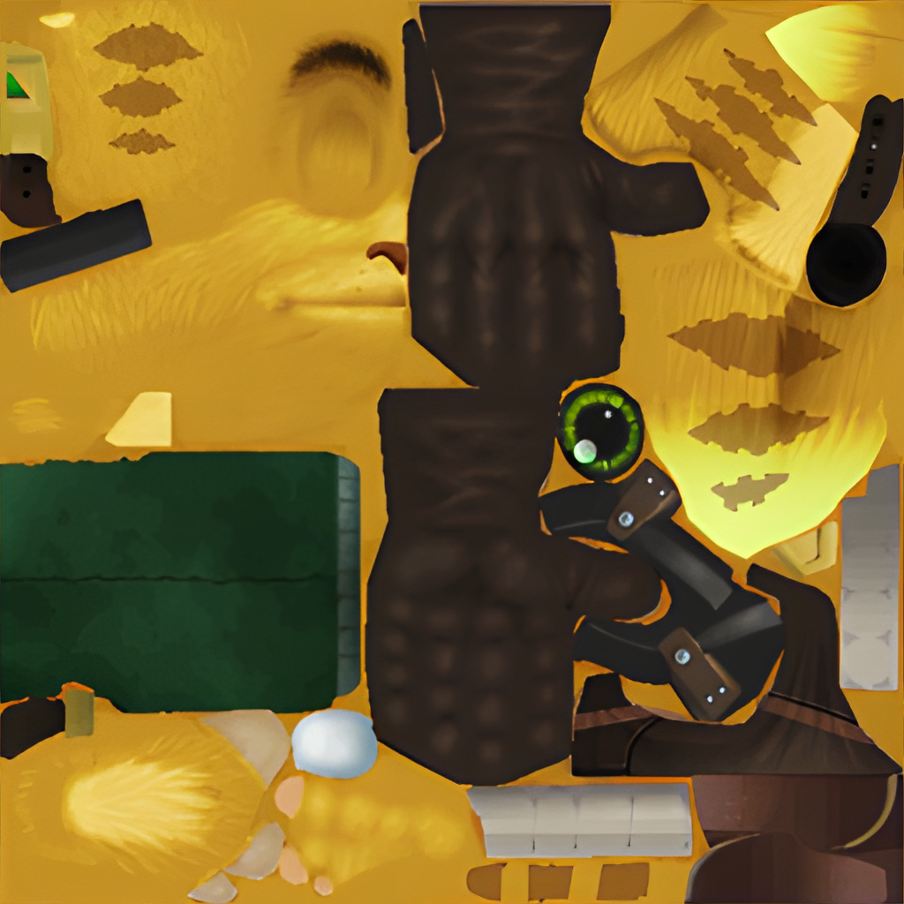
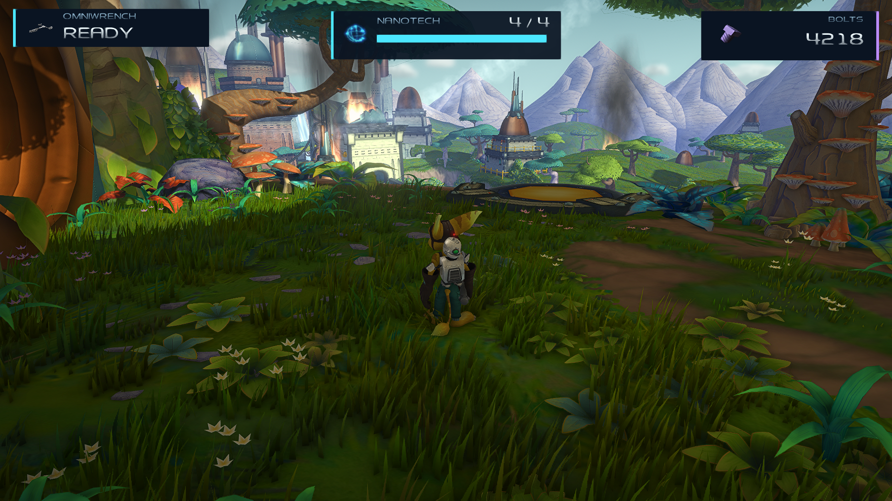
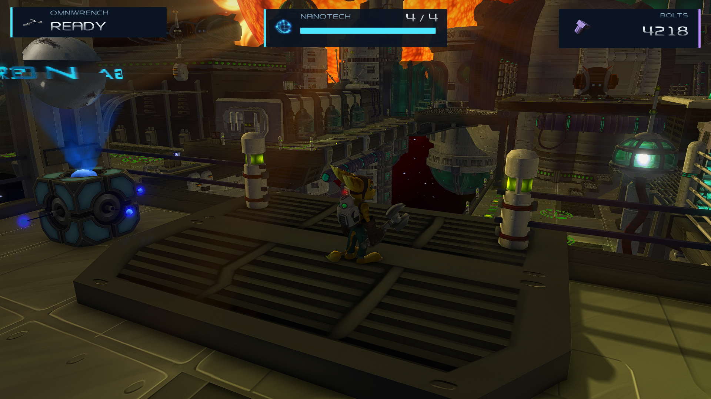

# RAC-RS Mods — Taurus0815

[Deutsch](#deutsch) · [English](#english) · [Vorschaubilder / Previews](#vorschaubilder--previews)

Eigene Mods für Ratchet & Clank 1 im PC-Port RAC-RS. / Custom mods for Ratchet & Clank 1 in the RAC-RS PC port.

**Ersteller / Author: Taurus0815**

## Downloads

Direkte ZIP-Downloads / Direct ZIP downloads:

| Paket / Package | Version | Download |
| --- | --- | --- |
| Modern Controls | 0.2.1 | [modern-controls-0.2.1.zip](downloads/modern-controls-0.2.1.zip) |
| Rift Modern | 0.15.0 | [rift-modern-0.15.0.zip](https://github.com/Taurus0815/RAC-RS-Mods/raw/refs/heads/main/downloads/rift-modern-0.15.0.zip) |
| HQ Texture Remake — **beide Teile / both parts** | 2.0.0 | [Teil 1 / Part 1](https://github.com/Taurus0815/RAC-RS-Mods/releases/download/hq-texture-remake-v2.0.0/hq-texture-remake-2.0.0-part01.zip) · [Teil 2 / Part 2](https://github.com/Taurus0815/RAC-RS-Mods/releases/download/hq-texture-remake-v2.0.0/hq-texture-remake-2.0.0-part02.zip) |
| HQ Texture Remake Lite — Figuren/Waffen / characters/weapons | 1.0.0 | [hq-texture-remake-1.0.0.zip](https://github.com/Taurus0815/RAC-RS-Mods/raw/refs/heads/main/downloads/hq-texture-remake-1.0.0.zip) |

[Prüfsummen der Mod-Pakete / mod package checksums](downloads/SHA256SUMS.txt) · [HQ 2.0.0 SHA-256](downloads/SHA256SUMS-HQ-2.0.0.txt)

## Deutsch

### Modern Controls

**0.2.1:** Übernimmt die Bewegungs-, Aim-, Schraubenschlüssel- und Bolt-Anziehungsfunktionen von Rift Modern. Dazu kommen zwei normale Treffer pro Nanotech-Orb, dreifache Original-Munitionsgrenzen und doppelte Ammo-Kisten, halbe Ammo-Shop-Preise und zehnfache Boltzuwächse. RAC-RS Auto-equip schaltet Swingshot, Hydrodisplacer und Trespasser bei Bedarf ein. Das originale HUD und die Menüs bleiben aktiv. Arsenal Mastery ist nicht erforderlich und wird nicht mitgeliefert.

**Installation:** [ZIP herunterladen](downloads/modern-controls-0.2.1.zip), entpacken, `modern-controls` nach `mods` kopieren und im Launcher aktivieren. Unter Spiel → Gameplay die native Option **Auto-equip gadgets** einschalten. Der [RAC-RS-Patch](native-patch/modern-controls-qspause-aim.patch) unterstützt Aim-Umschaltung und die Schnellwahl-Pause; er ändert keine Tastenbelegung.

### Rift Modern

**0.15.0:** Das Standard-HUD und die Originalmenüs bleiben aktiv; das Rift-HUD ist standardmäßig aus. Der doppelte kurze Druck auf die vom Launcher zugewiesene Aim-Taste schaltet das Anvisieren ein oder aus; gedrückt halten bleibt normales temporäres Zielen. Im pausierten Schnellrad erscheinen die beigefügten hochauflösenden 3D-Waffenbilder. Dafür ist der native RAC-RS-0.5.1-Patch erforderlich; ohne ihn nutzt das Mod die Originalbilder des Spiels.

- Native Kollision und Bewegung bleiben erhalten.
- **Zielen halten + Viereck** wirft den Schraubschlüssel über den ursprünglichen Comet-Strike-Ablauf.
- Schnellrad pausiert das Spiel; beim Loslassen wird die Auswahl übernommen.
- Bewegung, Schlaggeschwindigkeit, Aufschlag-Radien und Bolt-Anziehung bleiben einstellbar.

**Installation:** ZIP entpacken, den vollständigen Ordner `rift-modern` in `mods` kopieren und im Launcher aktivieren. Vorhandene Dateien vorher sichern. Für 3D-Waffenbilder den nativen RAC-RS-0.5.1-Patch `native-patch/rift-modern-rac-rs-0.5.1.patch` anwenden und den Player neu bauen. Ohne Patch bleibt das Rad funktionsfähig und zeigt die Originalbilder. Rift Modern vor HQ Texture Remake einordnen.
### HQ Texture Remake

Originalgetreue lokale **4×-Hochskalierung**: **4.415 unterschiedliche Grundtexturen, 26.818 PNG-Ersetzungen**. Version 2.0.0 erweitert das Pack auf Landschaften, Gebäude, Gegner, Gegenstände und Vegetation aller 19 Planeten sowie benannte Himmel-, Effekt-, Partikel-, HUD-, Titel-, Schiffs- und Warp-Texturen. Ratchet, Clank und die Waffen bleiben enthalten. UV-Anordnung, Seitenverhältnisse und originale Transparenz bleiben erhalten; die größte Ausgabe misst 2048 × 1024 Pixel.

**Installation:** **Beide ZIP-Teile von Version 2.0.0** herunterladen und in denselben `mods`-Ordner entpacken. Den enthaltenen Ordner `hq-texture-remake` zusammenführen, im Launcher aktivieren und das Spiel neu starten. Version 2.0.0 ersetzt 1.0.0. Die kleinere 1.0.0 bleibt als Alternative für Figuren und Waffen verfügbar. Rift Modern vor HQ Texture Remake einordnen. [Paket-Anleitung](mods/hq-texture-remake/README.md).

Die Dateizuordnungen wurden gegen alle 19 Planetendatensätze geprüft; zusätzlich wurden frühe und späte Planeten im Player geladen und visuell kontrolliert. Laufend erzeugte Render-Targets, Videos und vom Player ausdrücklich ausgenommene Effekt-Slots bleiben nativ. Ein vollständiger Spieldurchlauf ist kein Teil dieser Prüfung. Das Pack benötigt keinen eigenen Player-Build. Erstellt mit lokal ausgeführtem [Real-ESRGAN x4plus](https://github.com/xinntao/Real-ESRGAN).

### Prüfung und Umfang

Geprüft mit RAC-RS 0.5.1, PAL SCES-50916 v1.00, OmniLoader 0.1.0, Host-ABI 1.6 und Script-API 1.3. Ergebnisse und Grenzen stehen im [Testbericht](TESTBERICHT.md).

**Arsenal Mastery und Wardrobe sind nicht enthalten.** Persönliche Einstellungen, Speicherstände, Disc-Dateien und eine komplette Spielinstallation werden ebenfalls nicht mitgeliefert. Lizenzen und Herkunftsangaben liegen bei den jeweiligen Dateien.

## English

### Modern Controls

**0.2.1:** Carries over Rift Modern's movement, Aim, wrench and bolt-attraction features. It adds two ordinary hits per Nanotech orb, triple original weapon ammo limits and double crate ammo, half-price vendor ammo and 10x bolt gains. RAC-RS auto-equip handles the Swingshot, Hydrodisplacer and Trespasser when needed. Original HUD and menus stay active. Arsenal Mastery is not required or included.

**Install:** [Download the ZIP](downloads/modern-controls-0.2.1.zip), extract it, copy `modern-controls` to `mods` and enable it in the launcher. Turn on RAC-RS's native **Auto-equip gadgets** under Game → Gameplay. The [RAC-RS patch](native-patch/modern-controls-qspause-aim.patch) supports Aim toggle and Quick Select pause; it does not change button mappings.

### Rift Modern

**0.15.0:** The standard HUD and original menus remain active; the Rift HUD is off by default. Double-tap the launcher-mapped Aim action to toggle aiming, while a normal hold remains temporary aim. The paused Quick Select wheel can display the included high-resolution 3D weapon portraits. This requires the native RAC-RS 0.5.1 patch; without it, the mod falls back to the game's original artwork.

- Native collision and movement remain intact.
- **Hold Aim + press Square** to throw the Omniwrench with the original Comet Strike sequence.
- Quick Select pauses the game and commits the selection when released.
- Movement, wrench speed, impact radii and bolt attraction remain adjustable.

**Installation:** Extract the ZIP, copy the complete `rift-modern` folder into `mods` and enable it in the launcher. Back up existing files first. For the 3D weapon portraits, apply `native-patch/rift-modern-rac-rs-0.5.1.patch` and rebuild the player. Without the patch, the wheel still works and shows the original game pictures. Place Rift Modern above HQ Texture Remake.
### HQ Texture Remake

A faithful local **4× upscale**: **4,415 unique base textures and 26,818 PNG replacements**. Version 2.0.0 expands coverage to terrain, buildings, enemies, objects and vegetation across all 19 planets, plus named sky, effects, particles, HUD, title, ship and warp textures. Ratchet, Clank and weapons remain included. UV layout, aspect ratios and original transparency are preserved; the largest output is 2048 × 1024 pixels.

**Installation:** Download **both version 2.0.0 ZIP parts** and extract them into the same `mods` directory, merging `hq-texture-remake`. Enable it in the launcher and restart the game. Version 2.0.0 replaces 1.0.0. The smaller 1.0.0 remains available as a characters-and-weapons alternative. Place Rift Modern above HQ Texture Remake. [Package instructions](mods/hq-texture-remake/README.md).

File mappings were checked against all 19 planet datasets, with early and late planets also loaded and visually inspected in the player. Runtime render targets, videos and explicitly excluded effect slots remain native. These checks are not a full playthrough. The pack does not require a custom player build. Created with locally executed [Real-ESRGAN x4plus](https://github.com/xinntao/Real-ESRGAN).

### Verification and scope

Checked with RAC-RS 0.5.1, PAL SCES-50916 v1.00, OmniLoader 0.1.0, host ABI 1.6 and script API 1.3. Results and limits are documented in the [test report](TESTBERICHT.md).

**Arsenal Mastery and Wardrobe are not included.** Personal settings, save files, disc data and a complete game installation are also excluded. Each component includes its license and provenance information.

## Vorschaubilder / Previews

### Rift Modern — Auswahlrad / Quick Select

### HQ Texture Remake — Ratchet

Dieselbe Textur vor und nach der 4×-Hochskalierung, gleich groß dargestellt. / The same texture before and after 4× upscaling, displayed at equal size.

| Original — 256 × 256 | HQ Texture Remake — 1024 × 1024 |
| --- | --- |
|  |  |

### HQ Texture Remake 2.0.0 — Welt / World

Novalis:

Gemlik-Basis / Gemlik Base:

